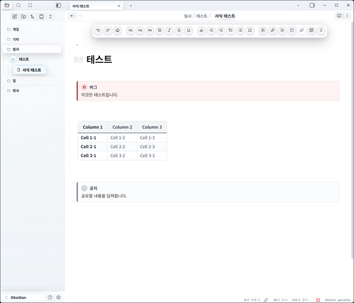
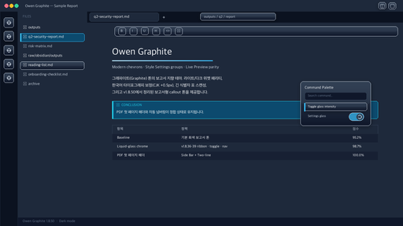
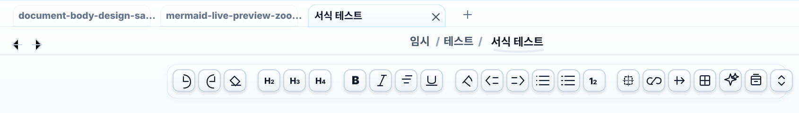
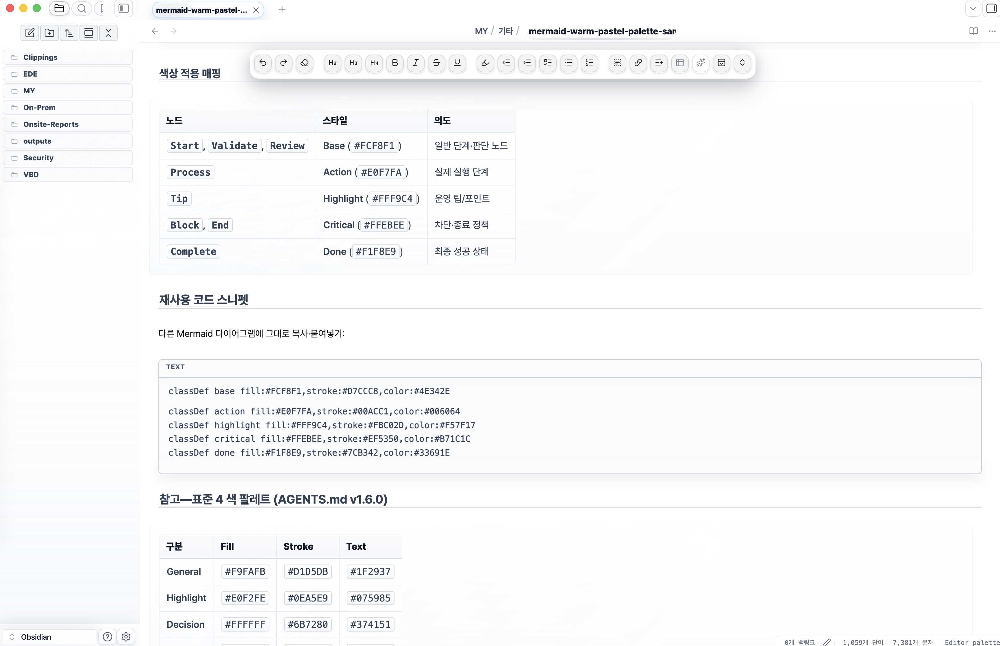
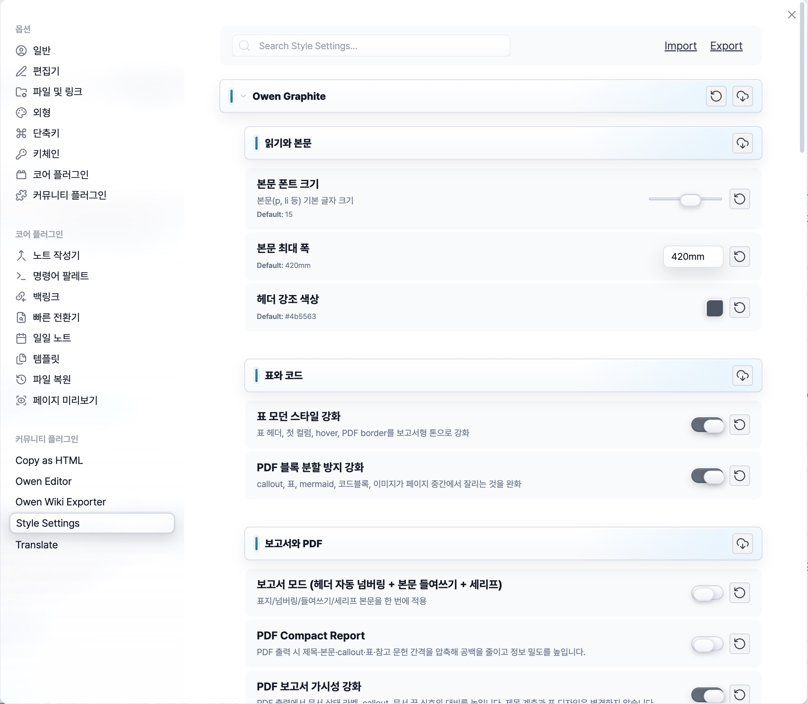
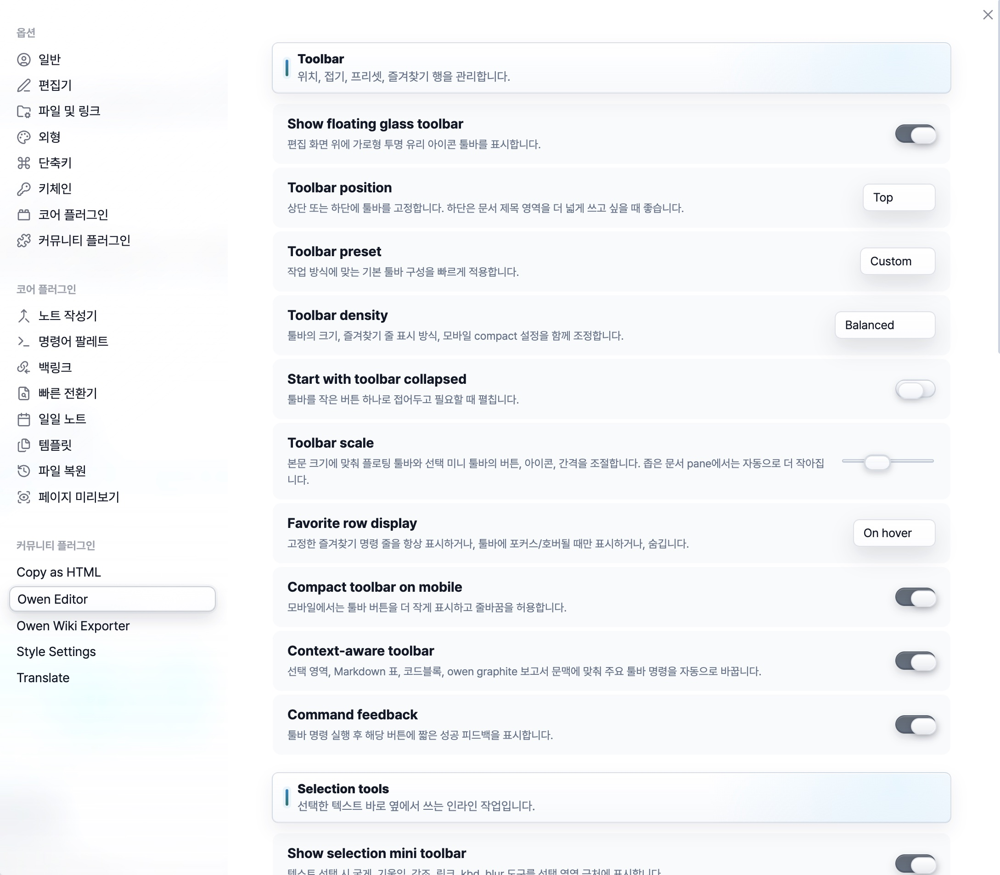
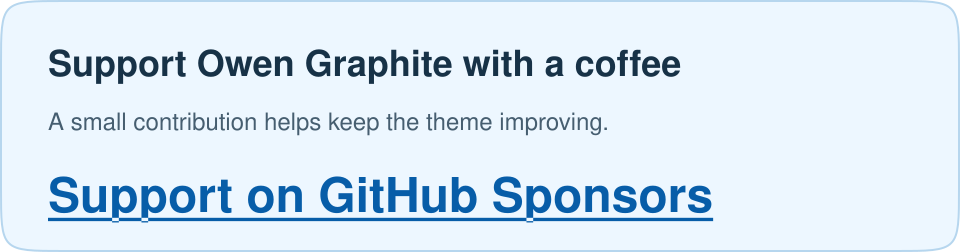

 
 
 

 

## The Owen stack

Pick the tool for the part of the workflow you want to improve. These projects work together, but you do not need to install everything.

| Project | Its role in your workflow |
| --- | --- |
| **[Owen Graphite](https://github.com/towishy/Owen-Graphite)** | Theme, typography, workspace styling, and PDF polish. |
| [Owen Editor](https://github.com/towishy/owen-editor) | Markdown authoring, editing commands, tables, and report helpers. |
| [Owen Exporter](https://github.com/towishy/owen-exporter) | SVG-to-image export and Markdown/HTML handoff workflows. |
| [Owen Mermaid](https://github.com/towishy/owen-mermaid) | Mermaid viewing, visual editing, and image export. |
| [Owen Wiki](https://github.com/towishy/owen-wiki) | A repository template for LLM-assisted knowledge operations. |

 

# Owen Graphite

**A quiet Obsidian theme for technical notes, knowledge work, and report-ready PDFs.**

Give your writing, tables, code, settings, and exported documents one calm graphite surface—without making every part of your workspace compete for attention.

**Obsidian theme · Light & dark · Desktop & mobile · English & Korean typography**

[Quick start](#quick-start) · [Features](#features) · [Preview](#preview) · [Documentation](#documentation)

 

## Preview

| Light workspace | Dark workspace |
| :---: | :---: |
|  |  |

The screenshots show Owen Graphite with Owen Editor. The theme styles the workspace; the editing toolbar is provided by Owen Editor.

More workspace and report previews

Use the [visual comparison guide](dev/WIKI/DOCS/v3/visual-comparison-guide.md) when capturing new comparisons.

 

## Features

| For your workflow | What Owen Graphite brings |
| --- | --- |
| Write and review | Balanced Korean/English typography, document spacing, code blocks, callouts, and dense tables across Live Preview and Reading View. |
| Navigate your vault | Restrained tabs, file-explorer treatments, wrapped title/metadata tooltips, search, settings, and workspace controls. |
| Prepare reports | PDF header/footer labels, page numbering, selected-paper readability presets, and page-break guards. |
| Tune your workspace | Style Settings options for typography, spacing, PDF layout, workspace chrome, and accessibility. |
| Work in either mode | A consistent light/dark theme for desktop and mobile Obsidian. |

> **Theme first. Plugins when you need them.** Owen Graphite owns the visual theme. Persistent code-title editing, code copying, and canonical Frosted ScrollArea controls are provided by Owen Editor—not by installing the theme alone.

 

## Quick start

### Install from Obsidian

1. Open **Settings → Appearance → Themes → Manage**.
2. Search for **Owen Graphite** and install it.
3. Enable the theme and choose your preferred light or dark mode.

Install the optional [Style Settings plugin](https://community.obsidian.md/plugins/obsidian-style-settings) to adjust report, typography, spacing, and workspace options.

<strong>Manual installation from GitHub Releases</strong>

1. Open the [latest release](https://github.com/towishy/Owen-Graphite/releases/latest).
2. Download the installable theme package. **Owen Graphite v3.1.105** (Release **3.1.105**) provides **`Owen-Graphite-3.1.105.zip`**.
3. Extract it into `<YourVault>/.obsidian/themes/Owen Graphite/` with `manifest.json` and `theme.css` directly inside.
4. Select **Owen Graphite** under **Settings → Appearance → Themes**.

GitHub's generated **Source code (zip)** is the repository archive, not the installable theme package.

<strong>Optional plugins: what each one adds</strong>

| Add-on | Install it when you need |
| --- | --- |
| [Style Settings](https://community.obsidian.md/plugins/obsidian-style-settings) | Access to typography, layout, PDF, and workspace settings. |
| Owen Graphite Companion | Korean Style Settings locale fallback, accessible custom dropdown lists, or structured title/metadata tooltips. |
| [Owen Editor](https://github.com/towishy/owen-editor) | Persistent code-title editing, copying, editing commands, and Frosted ScrollArea controls. |

The Graphite 3.1.105 release includes **`Owen-Graphite-Companion-1.3.2.zip`**. Extract its `owen-graphite-style-settings-l10n` folder into `.obsidian/plugins/`, reload Obsidian, and enable **Owen Graphite Companion**. Version 1.3.2 extends accessible custom dropdown lists and missing section headers to native settings and settings popouts while preserving the underlying setting values and descriptions.

The theme styles all preferences pages even without Style Settings or the companion. Native scrollbars use the UI Portal Frosted ScrollArea material while retaining proportional native thumbs. Owen Editor 0.6.39 or newer supplies the full fixed-length glass grip across workspace and settings windows; its settings-sidebar rail follows the panel's outer right edge.

Actual settings captures: [native preferences](screenshots/readme/settings-all-pages-light.png), [dark interface and zoom slider](screenshots/readme/settings-interface-dark.png), and [search and active filter contrast](screenshots/readme/settings-hotkeys-light.png).

Choose **Settings → Style Settings → Owen Graphite → Interface → Language** for the locale preference. The companion does not change Style Settings `data.json` or edit Markdown. Owen Editor stores code titles in fenced Markdown as `title="..."`.

 

## Everyday workflow

1. **Write naturally.** Use Markdown, tables, callouts, and code blocks in Live Preview or Reading View.
2. **Adjust once.** Choose typography, spacing, and report settings from **Settings → Style Settings → Owen Graphite**.
3. **Review the output.** Export a PDF and check the selected paper size, labels, and page breaks before sharing.

Start with the [Style Settings presets](dev/WIKI/DOCS/v3/style-settings-presets.md) rather than rebuilding recurring layouts.

 

## Compatibility and boundaries

- **The theme is not an editing plugin.** The screenshots include optional Owen Editor tools.
- **The companion does not edit Markdown.** It provides locale fallback and tooltip structure.
- **Settings are optional.** Style Settings exposes advanced controls, but the theme must still be enabled.
- **Review before delivery.** Screen appearance and PDF output are separate surfaces.

See the [plugin compatibility matrix](dev/WIKI/DOCS/v3/plugin-compatibility.md).

 

## Documentation

| Start here | What you will find |
| --- | --- |
| [Latest release](https://github.com/towishy/Owen-Graphite/releases/latest) | Installable theme and companion packages. |
| [Changelog](CHANGELOG.md) | Version-by-version changes. |
| [Feature history](dev/WIKI/DOCS/v3/feature-history.md) | Older feature and release notes. |
| [Settings presets](dev/WIKI/DOCS/v3/style-settings-presets.md) | Reusable workspace and report configurations. |
| [Compatibility](dev/WIKI/DOCS/v3/plugin-compatibility.md) | Theme/plugin ownership and integration details. |
| [Design specification](dev/WIKI/DOCS/v3/design-spec.md) | Design and validation contracts. |
| [Release plan](dev/WIKI/DOCS/v3/release-plan.md) | Bundle freshness, Style Settings, Live Preview, and PDF checks. |
| [Contributing](CONTRIBUTING.md) | Source layout, developer tools, and contribution guidance. |

 

## Contributing and license

After a successful release workflow, only the latest published release and its matching tag are retained. Older release downloads and tag-based rollback links are removed; source commit history is preserved. The retention workflow also supports a guarded dry run.

[Open an issue](https://github.com/towishy/Owen-Graphite/issues) with the Obsidian version, theme version, platform, and reproduction steps. Remove private note content from screenshots and examples.

Read the [contribution guide](CONTRIBUTING.md) before sending a change.

**License:** MIT — see [LICENSE](LICENSE).

---

 

## Support

  

 

  

Owen Graphite is free and open source. If it helps your report, wiki, or documentation workflow, you can support maintenance through [GitHub Sponsors](https://github.com/sponsors/towishy).
